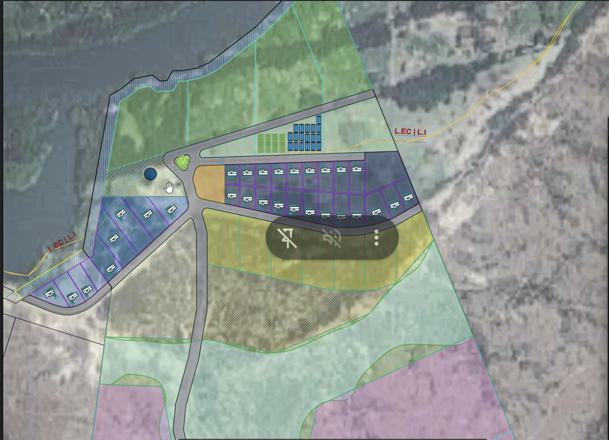

# 07 · Revisión del masterplan 2026-10-15

Volver a [[00 - Léeme]] · Método: [[10 - Guía de revisión regenerativa]] · Notas de la llamada: [[14 - Llamada 2026-10-15 Masterplanning Preliminar]] · Presentación: [[2026-10-15 Masterplan preliminar (presentación de Martín)]]

## 🌱 En un respiro

El primer enfoque de Martín es **el tipo de comienzo correcto para un proyecto regenerativo**: leyó los sistemas de agua del país y de la región antes que los lotes, dejó que el escurrimiento principal sea la columna verde (que por sí sola es ~10,2% del terreno, suficiente para el área verde legal), propuso avanzar por etapas desde el "cono" del río y dejó la parte alta, desértica, en lotes grandes sin definir. Lo que falta no son ideas sino **datos y números**: caudales pico, un derecho de agua, suelos, una línea de base de vegetación. El riesgo principal es el calendario: la presentación municipal congelaría líneas antes de que la tierra haya respondido.

**Con la presentación (v0.2, §3):** la etapa 1 tiene ahora números (118 ha; ~21% en conservación y restauración; 59% en lotes agrícolas) y el sitio, cuatro zonas (A 35 ha · B 83,5 · C 414,7 · D 464,8 = 998 ha). Los datos de NASA dicen que la lluvia **no** llega concentrada en uno o dos meses, sino repartida con picos en abril y octubre, con tormentas de más de 100 mm en un día. Dos marcas nuevas: el camino principal de 30 m que acompaña al cañadón y se cuenta como área verde, y los lotes ribereños en la planicie.

## 1. Qué se propuso [^call]

| Elemento | Propuesta |
|---|---|
| Relato | "El agua es vida"; el Río Negro como el único río argentino que une los Andes con el Atlántico; valle árido pero con abundancia de agua; la intervención humana puede hacer que un territorio dé más de lo que ofrece hoy |
| Matriz | Masterplan derivado del análisis hidrográfico: macro (país) → región (confluencia) → sitio |
| Columna verde | El escurrimiento efímero principal se mantiene como área verde / corredor de regeneración (10,22% del terreno); camino de acceso a lo largo de él que conecta Soluna con la meseta |
| Tesis del agua | Obras chicas de retención (piedras, ramas) y captaciones de lluvia a lo largo del valle para frenar el escurrimiento y "ganarle verde al desierto" con los años; quizás un punto de almacenamiento en el centro que junte más de la mitad del escurrimiento del terreno |
| Riego | Sobre todo por bombeo del río o de la napa, con permiso del DPA |
| Lotes (primer boceto) | Planicie aluvial con bosque ribereño: ~10 lotes de 5.000–30.000 m² · 24 lotes residenciales de 1.200–5.800 m² · el "embudo" (desembocadura) para restauración · parte alta de la etapa 1: 7 lotes de 4,5–22 ha · lotes más grandes más arriba |
| Etapa 1 | El "cono" de ~120 ha junto a Soluna, presentado solo para acelerar el trámite municipal |
| Ideas de programa | Centro comunitario/cowork/co-living junto al río (Franz); 4 lotes chicos comprados a Soluna como base; plantaciones de árboles nativos para madera certificada; vid/olivo (imagen "Toscana"); hub de I+D de regeneración |
| Proporción de rewilding | Gus: el 10% es poco; la mejor práctica ronda el 50%; crecer por etapas. Después de la llamada: **arrancar en 10% y llegar a un tope de 50%** (propuesta de Gus, ver [[08 - Rewilding y proporción ecológica]]) |

## 2. Revisión

### 🟢 Fortalezas
1. Diseño **guiado por el agua**: sigue la escala de permanencia de la permacultura (el agua antes que la subdivisión) ✅.
2. **Trabajar con el drenaje natural** en lugar de en contra: "interponernos sería un gasto energético y de dinero innecesario" ✅ — principio 7 (de los patrones a los detalles) y "el problema es la solución".
3. **Avanzar por etapas desde la zona mejor conocida** (el cono del río) y dejar abierta la meseta ✅ — soluciones pequeñas y lentas.
4. **Lotes de tamaños y usos diversos** ✅.
5. Reconoce la **restauración de la desembocadura** y del bosque ribereño ✅.
6. **Relato y datos integrados** (una sola línea narrativa para el diseño y la comunicación) ✅.
7. Humildad: el propio Martín pide un ingeniero y un equipo profesional diverso ✅.

### 🟡 A mejorar
1. **Estudio de caudales pico antes de cualquier obra en el cauce principal** — dimensiones, recurrencia, vertederos ([[04 - Agua en zonas áridas]] §4).
2. **El camino junto al escurrimiento**: los caminos que acompañan cauces se erosionan y concentran el agua; diseñar los cruces y el drenaje, y tratar el camino como una cuenca que alimenta árboles.
3. **Lotes residenciales en la planicie aluvial**: revisar las cotas de inundación (una crecida de ~50 cm podría inundar una franja grande [^tm05]) y la acumulación de aire frío (heladas) antes de fijarlos; considerar agrupar las casas en el borde más alto y estable y dejar la planicie para la producción y los bienes comunes.
4. **Cuadrícula rectangular en los lotes altos** (heredada de los cuadrados de 5 ha de Soluna — "el serrucho") — a Martín ya no le gusta; proponer líneas que sigan las curvas de nivel y las subcuencas.
5. **Vid y olivo "Toscana"**: necesitan agua (muchas veces 5.000–8.000 m³/ha/año en climas desérticos [verificar]) y datos de heladas: solo en lotes con derecho asegurado.
6. **Embalse central**: el agua libre se evapora rápido acá; compararlo con opciones de infiltración/recarga y diques de arena.
7. **Madera nativa "certificada"**: pocas especies del Monte dan madera rápido; revisar especies y esquema de certificación (¿FSC?) ❓.
8. **Meta de proporción ecológica**: hay propuesta de Gus (10% → tope de 50%), falta validarla con el equipo ([[08 - Rewilding y proporción ecológica]]).

### 🔴 Marcas (pausar hasta tener respuesta)
1. **Que no se presenten al municipio líneas de lotes en zonas sin datos de inundación y drenaje.** La presentación es el acto más permanente del año.
2. **Nada de movimientos de suelo en el cauce sin ingeniería y permiso** (los diques de una piedra hechos a mano en surcos chicos están bien como pilotos).
3. **Que no se comercialice ningún lote** (incluidos los 4 lotes junto a Soluna, si son del Lighthouse) antes de la aprobación según la Ord. 173 — regla legal de `../NS_Tokenomics/AGENTS.md`.

### ❓ Preguntas para Martín
Pasaron a [[13 - Preguntas abiertas y backlog]] §E "Preguntas para Martín", junto con las del agua y el DPA.

### ⏭ Próximo paso chico
Un **recorrido de un día** de Martín + Gus (+ un diseñador de permacultura) con una lista de control ([[templates/Observación de campo]]): puntos fotográficos en el escurrimiento, 3 calicatas, lista de plantas, marcar cárcavas y cabeceras, buscar marcas de inundación; después **una sesión de diseño de 2 horas** para acordar la proporción ecológica de la etapa 1.

## 3. Lo que agrega la presentación (v0.2, 2026-10-20)

Fuente: [[2026-10-15 Masterplan preliminar (presentación de Martín)]] (7 láminas). Lo que antes era [NC] por venir de la llamada ahora es [S] cuando está en una lámina.

### 3.1 Datos nuevos o confirmados

| Dato | Antes | Ahora |
|---|---|---|
| Superficie | 969 / 993,1 ha | **998 ha** en la lámina 5 y en la suma de las zonas: tercer número; sigue ❓ para el agrimensor (C6) |
| Escurrimiento principal | ~5,8 km [NC] | **5.760 m** [S]; perfil de ~215 a ~390 m s. n. m. en ~9,9 km: **pendiente media ~1,8%**, más empinada en la barda (km 6–7) |
| Zonas | "cono" de ~120 ha | **A** planicie aluvial con bosque ribereño, 35 ha ("Regeneration Project") · **B** barda baja, 83,5 ha · **C** barda alta, 414,7 ha · **D** cornisa y meseta, 464,8 ha. Etapa 1 = A + B = 118 ha |
| Lluvia | ~200 mm, torrencial, "julio el mes más lluvioso" [NC] | NASA POWER: **~257 mm/año** repartidos en todo el año, con picos de media en **abril (~30 mm) y octubre (~35 mm)**; máximos en un día de **~100 mm en enero, abril y octubre** y **285,7 mm en julio** [S, reanálisis; verificar] |
| Viento | del SO [NC] | **SO y OSO** dominantes, 5–9 m/s frecuentes, ráfagas de 12–15 m/s [S] |
| Heladas | sin dato | Mínimas **bajo cero de mayo a septiembre** (hasta ~−7 °C), colas de helada en abril y octubre; máximas de hasta ~43 °C [S, reanálisis] |
| Infraestructura existente | sin dato | **3 casas principales, 2 cabañas, caminos, energía, fibra y helipuerto (EANA)** [S] ❓ dónde están y de qué agua se abastecen |
| Contexto regional del agua | relato de la llamada | Río Negro: **930 m³/s** (~29.000 hm³/año), embalses que guardan >1 año de caudal, solo **11–16%** extraído [S, AIC/CFI] |

### 3.2 La etapa 1 en números (118 ha)

| Uso | ha | % de 118 |
|---|---|---|
| Lotes agrícolas (5+; el 3D muestra 7 lotes de 4,6–21,5 ha) | 69,7 | 59% |
| Área natural protegida + camino principal | 13,9 | 12% |
| Restauración del bosque ribereño | 11,3 | 10% |
| Lotes ribereños (etapas 0 y 1: 14 lotes) | 10,8 | 9% |
| Lotes residenciales (24, de 1.200 a 5.800 m²; media ~3.000 m²) | 7,1 | 6% |
| Sin asignar en la leyenda (camino de sirga de 20 m, calles, 1 lote de 1,13 ha) | ~5,2 | 4% |

Cuenta del agente [criterio]: conservación + restauración = 25,2 ha ≈ **21%** de la etapa 1, **más del doble del 10% legal** y dentro del escalón 20–25% propuesto en [[08 - Rewilding y proporción ecológica]]. Pero incluye el camino (ver 🔴 abajo).

### 3.3 Revisión

**🟢 Fortalezas nuevas**
1. **"Water is the asset. Regeneration is the strategy. The village is the outcome."** Es exactamente la tesis de [[17 - La regeneración como valor (las 300 razones)]], dicha por el arquitecto. ✅
2. **La lógica de la presentación es fractal**: Andes → río → valle → sitio → etapa. Es la escala que pide Maurício ([[16 - Estrategia fractal (de la región a la primera hectárea)]]). ✅
3. **Se pasa del mínimo legal**: 13,9 ha frente a 11,8 requeridas, más 11,3 ha de bosque ribereño. ✅
4. **El camino de sirga respeta la cota de inundación**: es la primera mención de una cota en los planos. ✅
5. **Las partes altas son macrolotes** (4 lotes de 50–168 ha y 4 de 61–130 ha): responde B4 y deja abierta la meseta. ✅
6. **La Zona A ("Regeneration Project", 35 ha) tiene casi el tamaño de lo que da Fibonacci en 7 años (~33–34 ha)**: un lugar natural para la primera hectárea y su crecimiento. 🧪 [criterio]

**🟡 A mejorar**
1. **La lluvia no es "una sola temporada"**: con picos en abril y octubre, conviene tener las obras piloto listas **antes de marzo y antes de septiembre**, y diseñar la captación para muchos eventos chicos más algunos muy grandes. Corrige lo dicho en la llamada (julio) y en la reunión con Maurício (uno o dos meses). [S, reanálisis]
2. **NASA POWER es una grilla de ~50 km**: sirve para el patrón, no para dimensionar obras. El máximo de 285,7 mm en un día de julio es muy alto para el Alto Valle y hay que contrastarlo con estaciones (INTA Alto Valle, SMN Cipolletti/Neuquén) antes de usarlo (C18). [verificar]
3. **Los rompevientos van perpendiculares al SO**, es decir, en líneas NO–SE. El cañadón ya da reparo; los lotes residenciales necesitan cortinas propias del lado SO.
4. **Heladas de mayo a septiembre, con riesgo en octubre**: confirma la duda sobre vid, olivo y almendro (C10) y pide medir las bolsas de frío en la planicie antes de fijar casas.
5. **69,7 ha agrícolas en un lugar de ~250 mm** solo funcionan con riego: necesitan el derecho de agua del DPA (C2) y un balance de agua por lote. Sugerencia: que esos lotes sean el lugar donde se aplique el ritmo Fibonacci, en vez de venderse como agrícolas desde el día uno.
6. **Las manchas rosadas** del mapa de la lámina 7 no tienen leyenda ❓ (¿pendientes?, ¿zonas planas?, ¿áreas de acumulación?).
7. **Nombres**: la Zona A se llama *Regeneration Project* y las B–D *Nature-positive Project*. Para la regla 7, "nature-positive" es una afirmación que necesita línea de base y monitoreo ([[09 - Monitoreo y Libro C]]).
8. **Erratas a corregir antes de mostrarla afuera**: "Analisis", "Subidivisión", "cumplis", "cociendo", "Corniza Meceta", "E02" repetido y el mismo texto de propiedad bajo los tres mapas.

**🔴 Marcas nuevas**
1. **El camino principal de 30 m acompaña al cañadón y se suma a la "área natural protegida"** (13,9 ha juntas). (a) Un camino a lo largo del cauce se corta en cada crecida y canaliza el agua (regla 1; [[Agua]]: los caminos son la primera obra de agua, por las crestas y con badenes). (b) Si el camino se descuenta, el área verde puede quedar **por debajo de las 11,8 ha** exigidas (1 km de camino de 30 m = 3 ha). **Pedir a Martín la superficie del camino por separado y su traza respecto del cauce.**
2. **14 lotes ribereños en la planicie aluvial** (regla 2): el camino de sirga de 20 m cumple la norma, pero no reemplaza **las cotas de inundación y el retiro ribereño** que pide [[08 - Rewilding y proporción ecológica]]. No fijarlos sin las cotas (C1, B5).

### 3.4 Preguntas nuevas para Martín
Pasaron a [[13 - Preguntas abiertas y backlog]] §E (11 a 15).

## 4. El loteo de detalle del cono (borrador, 2026-10-23)

Fuente: captura compartida por Gus y explicación de Martín en [[20 - Llamada 2026-10-23 con Martín y Maurício]] §3. Es un borrador para conversar y no tiene cotas ni superficies por lote.

### 🟢 Fortalezas
1. **La vivienda queda arriba de la línea de inundación** (L.EC / L.I), y debajo de la línea solo hay producción e invernaderos. Es lo que pedía §2 🟡3. ✅
2. **El corredor verde de ~200 m** (100 m a cada lado del eje) es más generoso que en la presentación. ✅
3. **Acceso público a la costa** como espacio comunitario y **reserva fiscal** pensada como servicio para el municipio: son la base de la **licencia social**. ✅
4. **La desembocadura del cañadón se destina a cosechar lluvia y a restauración**, no a lotes. ✅
5. **Las casas se orientan al norte** y se respetan los caminos heredados. ✅

### 🟡 A mejorar
1. **El programa es corto** (Maurício): son lotes más producción. Faltan los usos que se nombraron en la llamada (hub de investigación, voluntariado, vivero, glamping, mercado) y, sobre todo, **la primera hectárea** como área foco al pie de una subcuenca ([[16 - Estrategia fractal (de la región a la primera hectárea)]]). Sugerencia: marcar en este plano **dónde va la hectárea 1 y hacia dónde crece**.
2. **El bloque residencial es una cuadrícula de dos filas** (21–24 lotes de 400–1.200 m², más densos que los 1.200–5.800 m² de la presentación). Faltan **cortinas rompevientos del lado SO**, un recorrido del agua de los techos y las calles hacia cuencas de árboles, y espacios comunes dentro del bloque. Probar una forma de **cluster** (~16 familias) alrededor de un común ([[17 - La regeneración como valor (las 300 razones)]]).
3. **Calles que bajan hacia el río**: el camino N–S y la rotonda concentran escurrimiento hacia la costa. Hacen falta badenes y descargas a cuencas de infiltración ([[Agua]]).
4. **Invernaderos en la planicie inundable**: están permitidos, pero necesitan anclaje y drenaje pensados para la crecida, y agua con concesión (C2).
5. **Las manchas rosadas al sur** (¿lotes de etapas siguientes?) y el **área rayada marrón** no tienen leyenda ❓.

### 🔴 Marcas
1. **Lotes ribereños junto al codo del río**: el río erosiona ese codo y puede migrar. Se necesita **un retiro mayor que los 20 m del camino de sirga**, definido con la crecida de 100 años y un relevamiento fino (LiDAR), no con un MDE de 30 m (C1, C15).
2. **Ninguna línea de este loteo debería presentarse al municipio** sin el plano de la cota de inundación escriturada, un estudio de suelos mínimo y el programa (§2 🔴1).

## Fuentes y lógica usada

- La revisión aplica [[10 - Guía de revisión regenerativa]] a lo dicho en la llamada (§1–2) a la presentación de Martín (§3) y al loteo del 2026-10-23 (§4), transcripta en `sources/martin/`. Las cuentas de §3.2 y las lecturas de los gráficos son del agente.

[^call]: Llamada privada, Masterplanning Preliminar, 2026-10-15; ver [[14 - Llamada 2026-10-15 Masterplanning Preliminar]].
[^tm05]: Transcripción de la reunión de equipo del 2026-10-05 (Gabriel sobre la franja del río), `../NS_platform/Documentation/transcripts/Octubre/Team meeting 05-10.md`.
