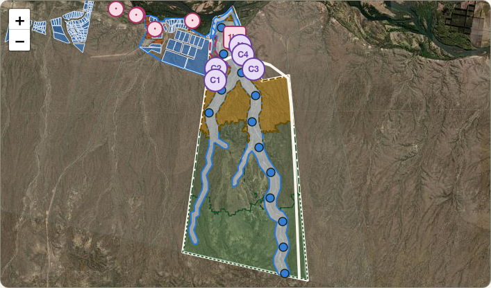

# 21 · Masterplan de permacultura v0.1 (alternativa)

Volver a [[00 - Léeme]] · Base: [[16 - Estrategia fractal (de la región a la primera hectárea)]], [[04 - Agua en zonas áridas]], [[20 - Llamada 2026-10-23 con Martín y Maurício]] · Revisión del loteo al que responde: [[07 - Revisión del masterplan 2026-10-15]] §4

## 🌱 En un respiro

Un primer **masterplan de permacultura** del Macrolote 7, armado por el agente desde el relieve y el agua, como **alternativa** a un loteo apurado. Sigue la escala de permanencia: clima y relieve → **agua** → caminos → árboles → estructuras → lotes. El hallazgo que lo ordena todo: **el cañadón drena ~2.000 ha, el doble del lote**, porque la mitad de su cuenca está en la meseta, fuera del predio [criterio, MDE 30 m]. Por eso el cañadón y sus ramales son la **columna verde** (~239 ha) y nadie vive cerca de ellos. Las casas van en **4 clusters de ~16 familias**, sobre dos terrazas planas a ~241 m, siempre por encima de cualquier crecida. La **primera hectárea** va al pie de una subcuenca de ~47 ha y crece en Fibonacci hasta ~34 ha al año 7. Proporción ecológica: **~52%**. Está en la plataforma como vista alternativa del territorio (PR #109 de lighthouse-platform, a revisar por Gus).

## 1. Qué se leyó del terreno [criterio; MDE de 30 m, con margen de error]

| Lectura | Resultado |
|---|---|
| Alturas dentro del lote | De ~213 m (planicie) a ~360 m (cornisa). Una rampa suave: pendiente mediana de ~3,6% y 90% del lote por debajo de 8,3% |
| Cuenca del cañadón principal | **~2.009 ha**: entra desde la meseta por el sur y el sudoeste, fuera del predio |
| Red de cauces | Dos ramales grandes (oeste y este) que se juntan en el centro-norte y bajan al río por un abanico ancho |
| Planicie por debajo de la cota 216 | ~18,6 ha (la cota escriturada del DPA va a reemplazar esta aproximación) |
| Terrazas aptas para vivir | Dos de ~15 ha cada una a ~241 m, con 2–3% de pendiente, a más de 120 m del cauce principal y a más de 80 m de los ramales |
| Área foco | Una subcuenca de ~47 ha que desagua al pie de la barda, junto a la planicie: relación ~47:1 (Mollison pide ≥20:1) |

## 2. La propuesta, por zonas

| Elemento | Zona | ha | Idea |
|---|---|---|---|
| Columna verde del cañadón | 4–5, bien común | ~239 | 100 m a cada lado del cauce y 40 m en los ramales; esparcir e infiltrar, no represar |
| Franja ribereña | 5, bien común | ~12 | Bosque de ribera; los sauces exóticos se reemplazan de a poco |
| Planicie inundable | 2–3, sin vivienda | ~4 | Chacra comunitaria, vivero, semillero |
| Desembocadura | 4, bien común | ~1 | Humedal de infiltración |
| **Primera hectárea** | Año 1 | 1 | Desvío en ladera, compost con poda del valle, testigo, línea de base |
| Crecimiento | Años 2–7 | 7 → 34 | Fibonacci, con lo que funcionó el año anterior |
| Núcleo común y puerta | 1 | ~3 | Visitantes, semillas, escuela, voluntariado (reserva fiscal), acceso público a la costa |
| 4 clusters | 0–1 | ~12 | ~16 familias cada uno alrededor de un común; **no son lotes en venta** |
| Huertas y frutales de los clusters | 2 | ~16 | Aguas grises a humedales, techos a cisternas |
| Agroforestería en curvas de nivel | 3 | ~148 | Solo con agua asegurada (DPA); si no, zona 4 |
| Monte manejado | 4 | ~285 | Medias lunas, zanjas, diques de una piedra; pastoreo solo como experimento |
| Meseta y cornisa | 5 | ~275 | Rewilding |
| Acceso por la divisoria este | Caminos | — | Por la huella existente y la loma; **un solo cruce** del cauce, con badén |
| Rompevientos | Sector SO | — | Líneas NO–SE a barlovento de cada cluster y de la hectárea 1 |
| 13 esparcidores de crecidas + tanque alto | Obras de agua | — | Cada ~550 m sobre el cañadón; el tanque da presión por gravedad y reserva contra incendios |

**Proporción ecológica** (ribera + columna verde + desembocadura + zona 5): **~518 de 998 ha ≈ 52%**. Ya en la v0.1 está en el tope de 50% de la regla 6 ([[08 - Rewilding y proporción ecológica]]).

## 3. En qué se diferencia del loteo actual

| Loteo del cono (2026-10-23) | Esta alternativa |
|---|---|
| Empieza por lotes y producción | Empieza por el agua y la primera hectárea |
| Camino principal junto al cañadón | Camino por la divisoria, un solo cruce |
| Corredor verde de ~200 m solo sobre el cauce principal | La columna verde incluye los ramales y reconoce que la cuenca es el doble del lote |
| Lotes ribereños junto al codo del río | Nada residencial en la planicie ni en la ribera |
| 21–24 lotes en cuadrícula | 4 clusters con comunes, protegidos del viento del SO |
| Sin programa explícito | Núcleo con programa (escuela, voluntariado, semillas, mercado) y crecimiento por etapas |

## 4. Lo que NO es y lo que falta

- **No es un plano.** Es una invitación a diseñar. Le faltan la visita al campo, la observación de varias estaciones y el diseño humano ([[15 - Reunión 2026-10-16 con Maurício Umann (Fractal)]], [[20 - Llamada 2026-10-23 con Martín y Maurício]]).
- **Datos que lo pueden cambiar:**
  - la cota de inundación escriturada (C1);
  - un relevamiento con drone y LiDAR (C15);
  - los suelos (C3, C20);
  - el derecho de agua (C2);
  - la crecida de diseño de Mainqué (C18);
  - la ubicación de las casas y la pista existentes.
- **El MDE de 30 m** confunde cauces chicos y desplaza líneas decenas de metros: ningún borde de esta propuesta sirve para mensura.
- La huella del borde este y el tanque alto son supuestos [verificar].

## 5. Cómo se reproduce

Los scripts están en `sources/masterplan-permacultura/`:

| Script | Qué hace |
|---|---|
| `analisis.py` | Recorta el MDE |
| `hidro.py` | Relleno de depresiones, dirección y acumulación de flujo, pendientes |
| `candidatos.py` | Planicie y terrazas aptas |
| `disenio.py` | Geometría y textos en español e inglés → `alternativa-permacultura.json` |

Se necesitan `rasterio`, `shapely`, `scipy` y `pyproj`, y el tile Copernicus `S40 W068` (AWS, abierto). Para cambiar la propuesta se edita `disenio.py`, se regenera el JSON y se copia a `lighthouse-platform/lib/territorios/`.

## Fuentes y lógica usada

- Copernicus DEM GLO-30 (ESA / AWS Open Data), tile `Copernicus_DSM_COG_10_S40_00_W068_00_DEM`. Imagen: Esri World Imagery. Polígono: `Biopueblo V11.kmz` (Macrolote 7, 998 ha calculadas).
- Criterios de diseño: [[Núcleo y método de diseño]], [[Agua]] (concentrar el agua, caminos como obras de agua, esparcir antes que represar), [[16 - Estrategia fractal (de la región a la primera hectárea)]] (1 ha → Fibonacci), [[17 - La regeneración como valor (las 300 razones)]] (clusters de ~16 familias).
- Todo lo de este doc es [criterio] del agente salvo que se indique otra cosa.
