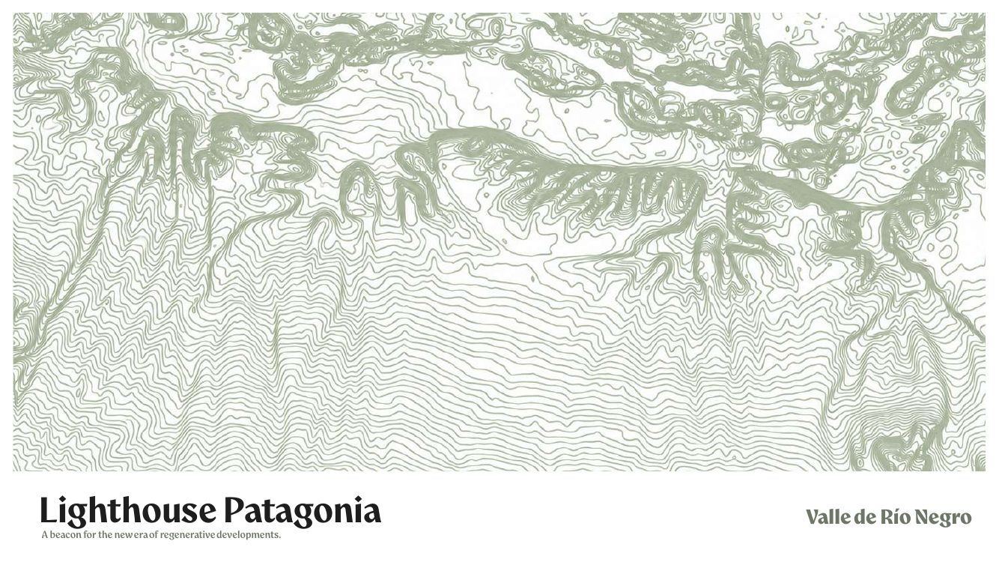
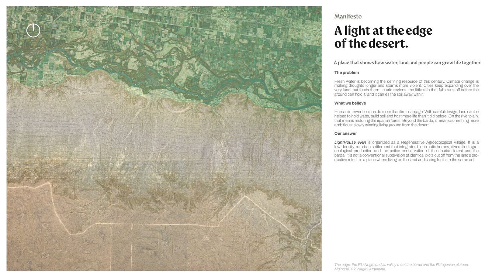
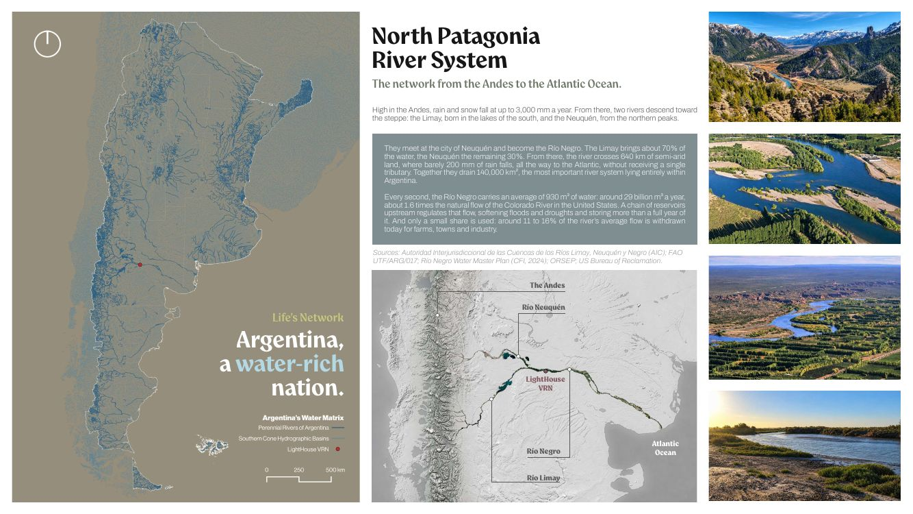
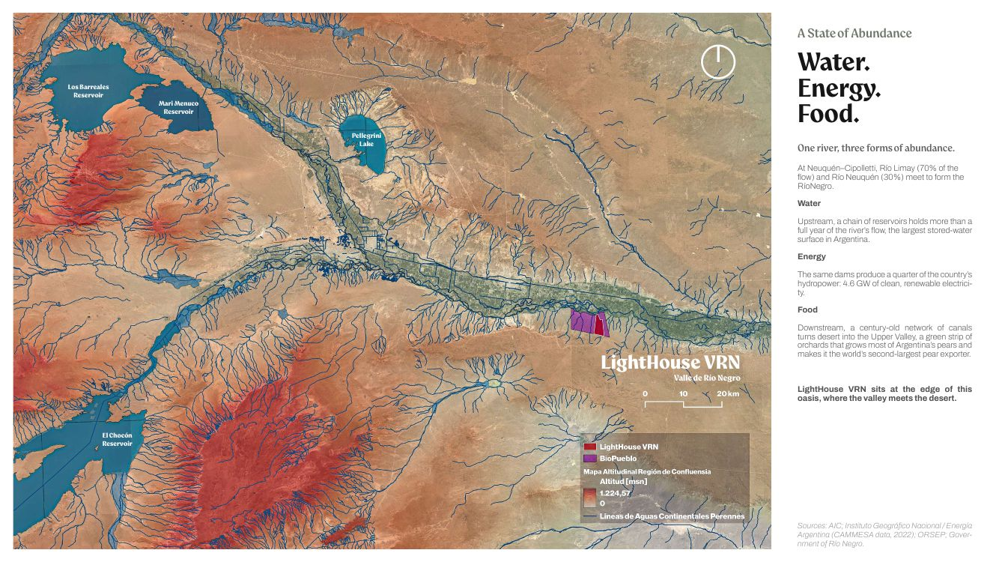
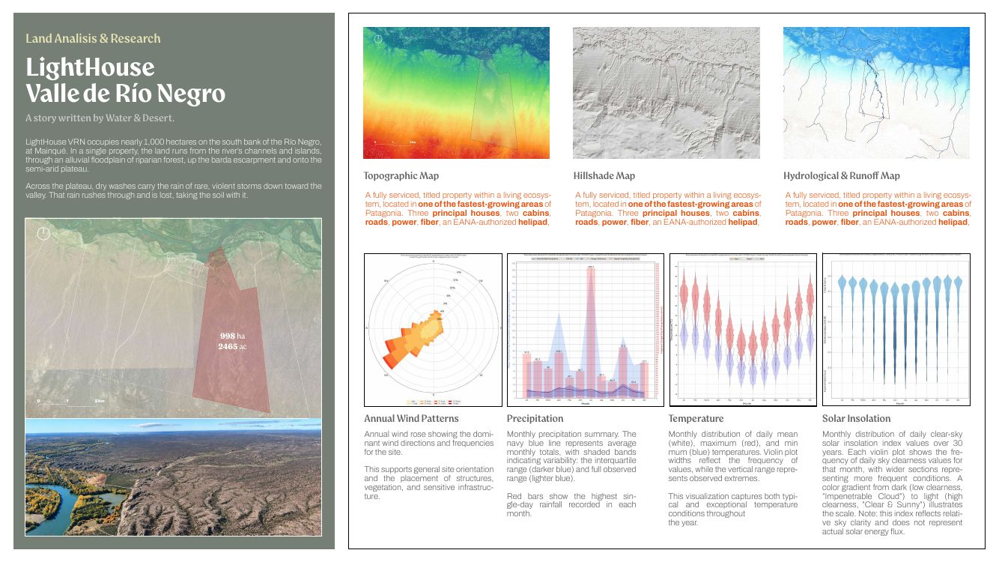
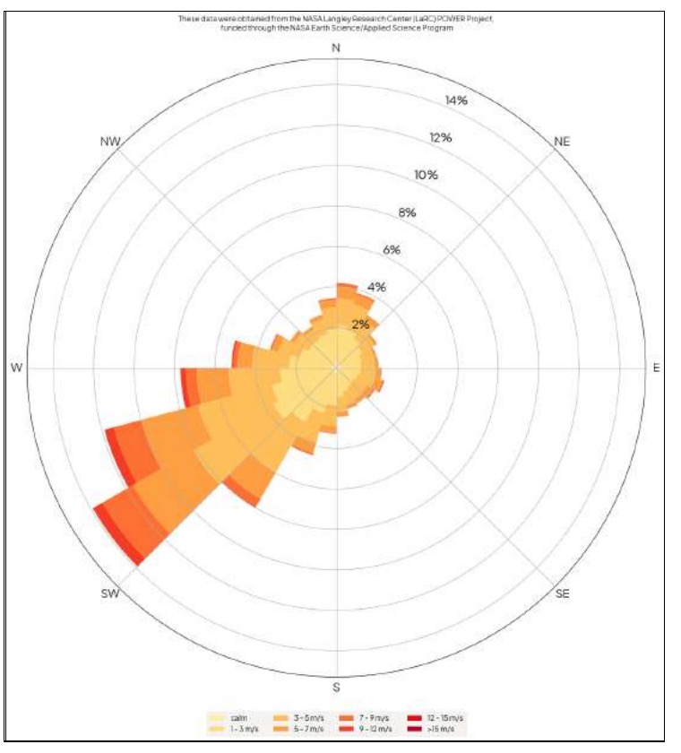
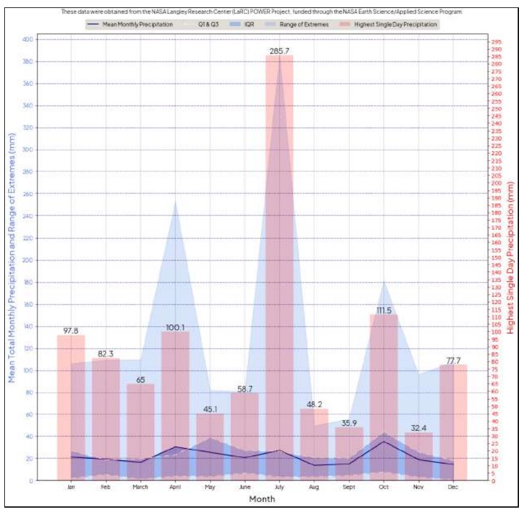
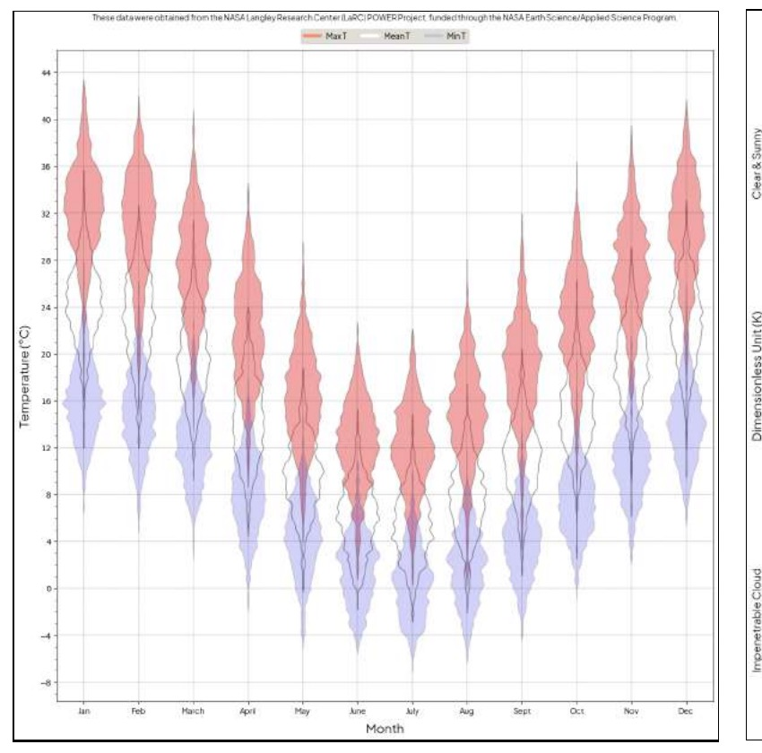
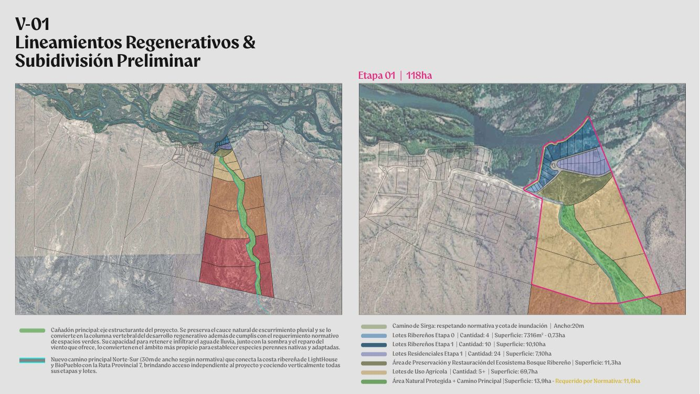
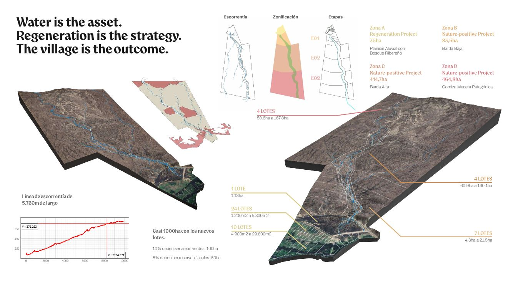

# Masterplan preliminar Lighthouse VRN — presentación de Martín (2026-10-15)

Volver a [[00 - Léeme]] · Qué aprendió el agente de esta presentación: [[07 - Revisión del masterplan 2026-10-15]] §3 · Perfil del sitio: [[01 - Perfil del sitio (Lighthouse 7A)]]

## 🌱 En un respiro

Siete láminas, de lo grande a lo chico: (1) portada, (2) manifiesto, (3) el sistema de ríos de la Norpatagonia, (4) el río como abundancia de agua, energía y alimento, (5) el análisis del sitio (topografía, sombreado, escurrimientos, viento, lluvia, temperatura y sol), (6) los lineamientos regenerativos y la subdivisión preliminar de la etapa 1 (118 ha) y (7) la "matriz hidráulica": la línea de escorrentía de 5.760 m, la zonificación en cuatro zonas y las etapas. El texto original está en inglés (láminas 1 a 5 y 7) y en español (lámina 6). Lema: **"Water is the asset. Regeneration is the strategy. The village is the outcome."**

---

## Lámina 1 · Portada

**Lighthouse Patagonia** — *A beacon for the new era of regenerative developments.* Valle de Río Negro.

## Lámina 2 · Manifiesto

> **A light at the edge of the desert.** A place that shows how water, land and people can grow life together.

- **The problem.** El agua dulce es el recurso que define este siglo. El cambio climático alarga las sequías y vuelve más violentas las tormentas. Las ciudades crecen sobre la tierra que las alimenta. En las regiones áridas, la poca lluvia escurre antes de que el suelo la retenga, y se lleva el suelo.
- **What we believe.** La intervención humana puede hacer más que limitar el daño: con diseño cuidadoso, la tierra puede retener agua, formar suelo y albergar más vida que antes. En la planicie del río, eso es **restaurar el bosque ribereño**; más allá de la barda, algo más ambicioso: **ganarle al desierto, despacio, suelo vivo**.
- **Our answer.** Lighthouse VRN se organiza como una **Aldea Agroecológica Regenerativa** (*Regenerative Agroecological Village*): un asentamiento **rururbano de baja densidad** que integra casas bioclimáticas, producción agroecológica diversificada y la conservación activa del bosque ribereño y de la barda. No es un loteo convencional de parcelas idénticas desconectadas del rol productivo de la tierra: es un lugar donde **vivir en la tierra y cuidarla son el mismo acto**.

Pie de foto: el borde donde el río Negro y su valle se encuentran con la barda y la meseta patagónica. Mainqué, Río Negro, Argentina.

## Lámina 3 · El sistema de ríos de la Norpatagonia

*The network from the Andes to the Atlantic Ocean.*

| Dato | Valor en la lámina |
|---|---|
| Lluvia y nieve en los Andes | hasta **3.000 mm/año** |
| Ríos de origen | Limay (lagos del sur) y Neuquén (picos del norte); se juntan en la ciudad de Neuquén y forman el río Negro |
| Aporte | Limay **~70%**, Neuquén **~30%** |
| Recorrido del río Negro | **640 km** de tierra semiárida, con apenas **200 mm** de lluvia, hasta el Atlántico, **sin recibir un solo afluente** |
| Cuenca | **140.000 km²**; el sistema fluvial más importante enteramente dentro de Argentina |
| Caudal medio | **930 m³/s** ≈ **29.000 millones de m³/año** (~1,6 veces el caudal natural del río Colorado de EE. UU.) |
| Regulación | Una cadena de embalses aguas arriba suaviza crecidas y sequías y almacena **más de un año** de caudal |
| Uso actual | Se extrae **~11–16%** del caudal medio para riego, ciudades e industria |

Fuentes citadas en la lámina: AIC (Autoridad Interjurisdiccional de las Cuencas de los Ríos Limay, Neuquén y Negro); FAO UTF/ARG/017; Plan Director de Aguas de Río Negro (CFI, 2024); ORSEP; US Bureau of Reclamation.

## Lámina 4 · *A State of Abundance*: agua, energía, alimento

*Argentina, a water-rich nation.* Mapa con los embalses Los Barreales, Mari Menuco, El Chocón y el lago Pellegrini, y la ubicación de Lighthouse VRN.

- **Agua.** Aguas arriba, los embalses guardan más de un año del caudal del río: la mayor superficie de agua embalsada de Argentina.
- **Energía.** Las mismas represas producen **un cuarto de la hidroelectricidad del país: 4,6 GW**.
- **Alimento.** Aguas abajo, una red de canales centenaria convierte el desierto en el **Alto Valle**, una franja de chacras que produce la mayoría de las peras de Argentina y lo hace el **segundo exportador mundial de peras**.

> *LightHouse VRN sits at the edge of this oasis, where the valley meets the desert.*

Fuentes citadas: AIC; IGN / Energía Argentina (datos CAMMESA, 2022); ORSEP; Gobierno de Río Negro.

## Lámina 5 · Análisis del sitio — *A story written by Water & Desert*

- Lighthouse VRN ocupa **casi 1.000 ha** en la margen sur del río Negro, en Mainqué. En una sola propiedad, la tierra va de los canales e islas del río, por una planicie aluvial con bosque ribereño, sube la escarpa de la barda y llega a la meseta semiárida.
- En la meseta, cauces secos llevan la lluvia de tormentas raras y violentas hacia el valle. Esa agua pasa rápido y se pierde, llevándose el suelo.
- Mapa de ubicación: **998 ha / 2.465 acres**.
- Texto repetido bajo los tres mapas (topográfico, sombreado, hidrológico y de escurrimiento): propiedad con todos los servicios y escriturada, en una de las zonas de mayor crecimiento de Patagonia. **Tres casas principales, dos cabañas, caminos, energía, fibra óptica y un helipuerto autorizado por la EANA.**

Gráficos de clima (datos: NASA Langley Research Center, proyecto **POWER**, serie de ~30–40 años):

| Gráfico | Qué muestra |
|---|---|
|  | **Rosa de vientos anual.** Sirve para orientar el sitio y ubicar estructuras, vegetación e infraestructura sensible |
|  | **Lluvia mensual.** Línea azul: promedio mensual; bandas: rango intercuartil y extremos; barras rojas: **la lluvia máxima registrada en un solo día** en cada mes |
|  | **Temperatura.** Distribución mensual de la media (blanco), la máxima (rojo) y la mínima (azul) diarias |
| (en el PDF) | **Insolación.** Índice de claridad del cielo por mes en 30 años (no es energía solar medida) |

Lectura del agente de los gráficos (valores leídos a ojo, ±2 mm o ±1 °C) [S: NASA POWER, vía Martín]:

| Mes | E | F | M | A | M | J | J | A | S | O | N | D | Año |
|---|---|---|---|---|---|---|---|---|---|---|---|---|---|
| Lluvia media (mm) | ~21 | ~19 | ~16 | ~30 | ~27 | ~21 | ~27 | ~13 | ~14 | ~35 | ~19 | ~15 | **~257** |
| Máx. en un día (mm) | 97,8 | 82,3 | 65 | 100,1 | 45,1 | 58,7 | 285,7 | 48,2 | 35,9 | 111,5 | 32,4 | 77,7 | — |

- **Viento:** dominante del **SO y OSO** (cada uno ~12–14% del tiempo), después del O; velocidades frecuentes de 5–9 m/s, con ráfagas de 12–15 m/s.
- **Temperatura:** máximas de hasta ~43 °C en enero; **mínimas bajo cero de mayo a septiembre** (hasta ~−7 °C en julio) y colas de helada en abril y octubre; amplitud diaria de ~15–18 °C.

## Lámina 6 · V-01 Lineamientos regenerativos y subdivisión preliminar

Mapa general (izquierda), con el texto original:

- **Cañadón principal: eje estructurante del proyecto.** "Se preserva el cauce natural de escurrimiento pluvial y se lo convierte en la columna vertebral del desarrollo regenerativo, además de cumplir con el requerimiento normativo de espacios verdes. Su capacidad para retener e infiltrar el agua de lluvia, junto con la sombra y el reparo del viento que ofrece, lo convierten en el ámbito más propicio para establecer especies perennes nativas y adaptadas."
- **Nuevo camino principal Norte-Sur** (**30 m de ancho** según normativa) que conecta la costa ribereña de Lighthouse y BioPueblo con la **Ruta Provincial 7**, da acceso independiente al proyecto y "cose" verticalmente todas sus etapas y lotes.

**Etapa 01 | 118 ha** (derecha):

| Elemento | Cantidad | Superficie |
|---|---|---|
| Camino de sirga ("respetando normativa y cota de inundación") | — | ancho **20 m** |
| Lotes ribereños etapa 0 | 4 | 7.316 m² (0,73 ha) |
| Lotes ribereños etapa 1 | 10 | 10,10 ha |
| Lotes residenciales etapa 1 | 24 | 7,10 ha |
| Área de preservación y restauración del ecosistema de bosque ribereño | — | 11,3 ha |
| Lotes de uso agrícola | 5+ | 69,7 ha |
| Área natural protegida + camino principal | — | 13,9 ha (**requerido por normativa: 11,8 ha**) |

## Lámina 7 · La matriz hidráulica: escorrentía, zonificación y etapas

> **Water is the asset. Regeneration is the strategy. The village is the outcome.**

- **Tres esquemas en serie:** *Escorrentía* (la red de cauces sobre el polígono) → *Zonificación* (bandas del río a la meseta, con la columna verde del cañadón) → *Etapas* (E01 abajo; las etapas siguientes hacia arriba; la lámina rotula "E02" dos veces).
- **Línea de escorrentía de 5.760 m de largo**, con un perfil longitudinal: de ~215 m s. n. m. junto al río a ~376 m a los 8.235 m y ~390 m al final del perfil (~9,9 km).
- Dos modelos 3D del terreno con la red de escurrimientos, y un mapa del polígono con la red de cauces y **manchas rosadas sin leyenda** ❓.

| Zona | Nombre en la lámina | Paisaje | Superficie |
|---|---|---|---|
| **A** | *Regeneration Project* | Planicie aluvial con bosque ribereño | **35 ha** |
| **B** | *Nature-positive Project* | Barda baja | **83,5 ha** |
| **C** | *Nature-positive Project* | Barda alta | **414,7 ha** |
| **D** | *Nature-positive Project* | Cornisa y meseta patagónica | **464,8 ha** |
| | | **Total** | **998 ha** |

Lotes rotulados en el modelo 3D (de abajo hacia arriba):

| Lotes | Tamaño |
|---|---|
| 10 lotes | 4.900 m² a 29.800 m² |
| 24 lotes | 1.200 m² a 5.800 m² |
| 1 lote | 1,13 ha |
| 7 lotes | 4,6 ha a 21,5 ha |
| 4 lotes | 60,9 ha a 130,1 ha |
| 4 lotes | 50,6 ha a 167,8 ha |

- "Casi 1.000 ha con los nuevos lotes. **10% deben ser áreas verdes: 100 ha. 5% deben ser reservas fiscales: 50 ha.**"

---

## Fuentes y lógica usada

- PDF original: `261015_LHS-VRN_Masterplan Preliminar.pdf` (en esta carpeta), aportado por Gus el 2026-10-19. Las imágenes de `img/` son renders de sus láminas.
- La tabla de lluvia mensual y las lecturas de viento y temperatura son lecturas del agente sobre los gráficos (no vienen como números en la lámina, salvo los máximos diarios). NASA POWER es un dato de **reanálisis en grilla** (celdas de ~50 km), no de una estación: sirve para el patrón, no para dimensionar obras [criterio].
- Lo que el agente aprendió de esta presentación y sus marcas están en [[07 - Revisión del masterplan 2026-10-15]] §3.
